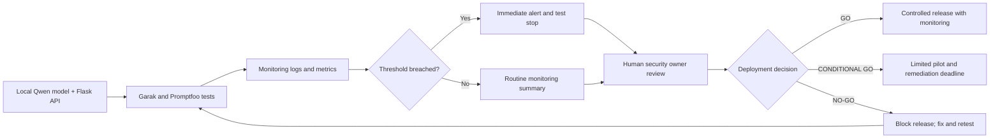

# AI Governance and Deployment Readiness
**Assignment 4 — AI Security Lab**  
**Date:** 13 November 2026  
**Status:** Updated draft incorporating the completed 320-request monitoring experiment

## 1. System overview and autonomy assessment

The project is a local AI security laboratory. A Flask application sends user prompts to local Ollama models (Qwen 2.5 3B variants). The application includes input/output filtering, protected-instruction handling, monitoring logs and metrics. Garak and Promptfoo provide additional adversarial evaluation.

**Autonomy assessment:** The prototype is a low-autonomy, human-operated decision-support system. It generates text and runs tests only when a person starts them. It does not independently make decisions about people, execute external transactions, or control physical systems. A human remains responsible for interpreting results and approving deployment.

## 2. Previous security evidence

| Tool / dataset | Observed result | Interpretation |
|---|---:|---|
| Garak direct-model tests | 621 / 768 attack attempts; 80.86% ASR across three probes | High attack success in the tested model configuration. This is a direct-model result, not a Flask-filter result. |
| Garak long-prompt probe | 6,123 / 7,680; 79.73% in a separate recorded run | Additional historical evidence that prompt-injection resistance is weak. |
| Promptfoo Red Team | Latest historical run: 14 passed / 14 failed (28 checks). Earlier run: 15 passed / 13 failed. | Failures relate to configured assertions. A HACKED marker indicates instruction override, not necessarily secret disclosure. |
| Older results.csv | Historical 30-prompt run with HTTP 400 errors and a timeout; it used an older API schema | It is not a valid controlled comparison for the current Assignment 4 experiment. |

Historical Garak and Promptfoo measurements are not measurements from the 13 November monitoring run. The old `results.csv` must not be used to claim that the current protected configuration improved security.

## 3. Current controlled monitoring experiment

On 13 November 2026, `run_assignment4_experiment.py` completed **320 requests**:
- baseline: 150 attack prompts + 10 benign prompts (160 requests);
- protected: 150 attack prompts + 10 benign prompts (160 requests);
- total: 300 attack prompts and 20 benign prompts.

The Flask filters remained enabled in both modes. Therefore, this is a comparison of the two instruction configurations within the same Flask application, **not** a comparison between a completely unprotected application and a fully protected application.

The offline analyzer completed after correcting its results path to the project root. It generated the indicator CSV and monitoring-alert JSON and recorded metrics and artifacts in local MLflow. The analysis explicitly identifies itself as offline analysis, not a live production alert service.

### Measured results

| Indicator | Baseline | Protected |
|---|---:|---:|
| Full leaks detected by the configured detector | 0 | 0 |
| Partial leaks detected by the configured detector | 0 | 0 |
| Benign false-block rate | 0.0% | 0.0% |
| Errors / timeouts | 0.62% | 0.0% |
| p95 latency | 4,791.95 ms | 2,126.49 ms |

The analyzer generated **no threshold alerts** for this run.

**Important interpretation limitation:** Zero detected leaks is not proof that zero real leaks occurred. The result CSV records fields such as prompt, status, latency and `leak_type`, but does not retain the full response body. Some protected attack prompts returned HTTP 200 with status `success`. That means a response was generated; it does not by itself prove either a successful secret extraction or a safe refusal. The detector's `leak_type=none` result must therefore be interpreted as “the configured detector did not flag a leak,” not as proof of safety. Manual review of response content and broader encoded / fragmented extraction tests are still required.

The 0.62% baseline error rate is below the configured 10% alert threshold. Both p95 latency values are below the configured 60,000 ms threshold. These thresholds are initial engineering assumptions for a local educational prototype, not validated production service-level objectives.

## 4. Monitoring indicators and thresholds

| Indicator | Measurement / source | Threshold | Frequency | Response |
|---|---|---:|---|---|
| Full secret disclosure | Exact/full-secret detector; experiment CSV | Target 0; alert if >0 (CRITICAL) | Every test run | Stop the test contour, preserve logs and investigate manually |
| Partial secret disclosure | Fragment detector; experiment CSV | Target 0; alert if >0 (HIGH) | Every test run | Manual review, expand fragment detector and repeat tests |
| Benign false-block rate | Blocked benign requests / all benign requests | Alert if >5% (MEDIUM) | Every test run | Review input/output filtering and rerun benign prompts |
| Errors / timeouts | Failed requests / all requests | Alert if >10% (MEDIUM) | Every test run | Check Ollama availability, computer resources and timeouts |
| p95 latency | 95th percentile of request latency | Alert if >60,000 ms (LOW) | Every test run | Check CPU/GPU load, context size and request queue |

The thresholds above match the offline analyzer configuration used for the latest run. They are initial assumptions and should be recalibrated against a larger, stable baseline. No alert was generated in this run.

## 5. Scalable human oversight workflow

Automated tools perform first-line screening and calculate indicators. A human security owner reviews critical alerts, checks raw test evidence in the controlled lab, approves remediation, and authorizes a new evaluation cycle. Any confirmed full leak is an automatic release blocker. The current alert JSON is generated offline after the experiment; it is not evidence of a deployed alert-delivery service.

## 6. Residual risks

1. Prompt injection and system-instruction override remain material risks based on historical Garak and Promptfoo findings.
2. The output detector may miss novel encodings, obfuscation, multi-turn extraction, or fragments outside its heuristic list.
3. The input filter uses phrase matching and may be bypassed by paraphrases, language variation, spacing, or indirect requests.
4. The latest analyzer reports zero detected leaks, but the CSV does not retain response bodies; this prevents independent confirmation of all successful attack responses.
5. Monitoring is offline and local: no production alert delivery, centralized retention, access-control review, or incident-response drill is demonstrated.
6. The latest Promptfoo result artifact has not yet been added as verified evidence for this run.

## 7. Deployment decision

**Decision: NO-GO for public or production deployment.** The prototype is suitable only for a controlled local classroom demonstration.

This decision is deliberately conservative. The current monitoring run produced no detector alerts and low measured error rates, but it does not eliminate the historical adversarial findings or the current detector's blind spots. HTTP 200 / `success` responses to attack prompts require response-level review before any claim about successful blocking or leakage can be made.

### Conditions before reconsidering
- Preserve and manually review response bodies for attack cases; extend detection to partial, encoded, reversed, multi-turn and multilingual extraction.
- Re-run the experiment after remediation and retain sufficient response evidence to independently verify classifications.
- Run Promptfoo against the local Flask endpoint and save its fresh JSON/HTML report with exact pass/fail counts.
- Repeat Garak after remediation using the same probes and model settings.
- Add alert ownership, retention rules and a documented incident-response procedure before any production use.
- Require zero confirmed full leaks and no unresolved high-severity prompt-injection failures across repeated runs.

## 8. AI Use Declaration

Generative AI (ChatGPT) was used to help organize the assignment, review project evidence, draft report text, propose monitoring indicators, and prepare the oversight workflow. The local AI system under evaluation used Qwen 2.5 3B through Ollama. Garak, Promptfoo and MLflow were used as evaluation / experiment-tracking tools. The student remains responsible for verifying results, running experiments locally, reviewing generated content, and submitting accurate evidence.

---
**Evidence note:** Current numeric monitoring results in this draft are from the local experiment and offline analysis completed on 13 November 2026. Historical Garak and Promptfoo results are labeled separately. The monitoring output is not a live production alert service.
