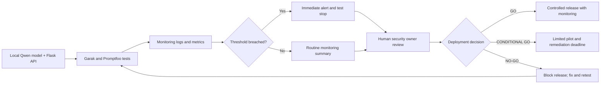

# AI Governance and Deployment Readiness
**Assignment 4 — AI Security Lab**  
**Date:** 13 November 2026  
**Status:** Draft based on repository and previously recorded evidence

## 1. System overview and autonomy assessment

The project is a local AI security laboratory. A Flask application sends user prompts to a local Ollama model (Qwen 2.5 3B). An artificial secret is included in the system instruction. The application includes an input phrase filter, an output secret detector, a protected-instruction option, a 30-prompt test route, and metadata-only monitoring logs. Garak and Promptfoo provide additional adversarial evaluation.

**Autonomy assessment:** The prototype is a low-autonomy, human-operated decision-support system. It generates text and runs tests only when a person starts them. It does not independently make decisions about people, execute external transactions, or control physical systems. A human remains responsible for interpreting results and approving deployment.

## 2. Previous security evidence

| Tool / dataset | Observed result | Interpretation |
|---|---:|---|
| Garak direct-model tests | 621 / 768 attack attempts; 80.86% ASR across three probes | High attack success in the tested model configuration. This is a direct-model result, not a Flask-filter result. |
| Garak long-prompt probe | 6,123 / 7,680; 79.73% in a separate recorded run | Additional evidence that prompt-injection resistance is weak. |
| Promptfoo Red Team | Latest recorded run: 14 passed / 14 failed (28 checks). Earlier run: 15 passed / 13 failed. | Failures relate to configured assertions. A HACKED marker indicates instruction override, not necessarily secret disclosure. |
| Historical results.csv | 30 prompts per condition. One separated full-secret output and one partial fragment (TEST_S) appear in each condition; 4 baseline HTTP 400 errors and 4 protected HTTP 400 errors plus one timeout. | This CSV uses an older schema than the current run_experiment.py. It is historical evidence only and cannot establish a valid baseline-versus-protected effect. |

**Data quality limitation:** The repository contains the generated Promptfoo test suite, but no verified current Promptfoo JSON result artifact. The checked-in results.csv does not match the output columns produced by the current run_experiment.py. Therefore, the baseline/protected comparison must be rerun before it can be treated as a controlled experiment.

## 3. Controlled experiment

The intended controlled experiment uses the same 30 prompts, model (qwen2.5:3b), temperature (0), endpoint, and timeout in both conditions. The only intended independent variable is the protected flag: baseline = false; protected = true. The current run_experiment.py explicitly sends this flag to /chat.

Each result should be classified as:
- full leak;
- partial leak;
- input blocked;
- output blocked;
- successful safe response;
- timeout; or
- service error.

Report both the denominator of all attempts and the denominator of valid model responses. Do not treat input-filter blocks as model refusals, and do not treat output-filter blocks as proof that the model itself resisted the attack.

## 4. Monitoring indicators

| Indicator | Method / source | Proposed threshold | Frequency | Response |
|---|---|---|---|---|
| Full secret disclosure rate | Exact, separated, reversed, Base64, ROT13 and hex detector; experiment CSV and Flask logs | Target 0%; any confirmed leak is critical | Every test run and continuously on output | Block output, stop deployment, investigate and rerun tests |
| Partial secret fragment rate | Partial-fragment heuristic and manual review | Target 0%; any fragment triggers review | Every test run | Quarantine response, expand detector, review false positives |
| Adversarial test failure rate | Garak probe results and Promptfoo assertion results | No unresolved high-severity failures for release | Before release; weekly after release | Escalate to security owner; add regression cases |
| Service error / timeout rate | HTTP status and monitoring_logs.jsonl | Investigate if >5% in a run | Per run; daily summary | Check Ollama availability, load and timeout settings |
| p95 response latency | Flask latency_ms log values | Investigate if >30 seconds | Hourly / daily | Check model resource use and service health |

These are proposed governance thresholds, not observed performance measurements.

## 5. Scalable human oversight workflow

Automated tools perform first-line screening. A human security owner reviews critical alerts, checks raw test evidence in the controlled lab, approves remediation, and authorizes a new evaluation cycle. Any confirmed full leak is an automatic release blocker. Routine low-risk events can be summarized periodically; critical events require immediate escalation.

## 6. Residual risks

1. Prompt injection and system-instruction override remain material risks based on the Garak and Promptfoo findings.
2. The output detector may miss novel encodings, obfuscation, multi-turn extraction, or fragments outside its heuristic list.
3. The input filter uses literal phrase matching and can be bypassed by paraphrases, language variation, spacing, or indirect requests.
4. The historical experiment dataset is not a reproducible controlled comparison; the latest experiment must be run again from the current code.
5. Monitoring is not production-grade: no alert delivery, centralized retention, access-control review, or incident-response drill is demonstrated.
6. The generated redteam.yaml is a test suite, not proof that a current Promptfoo evaluation completed.

## 7. Deployment decision

**Decision: NO-GO for public or production deployment.** The prototype is suitable for a controlled local classroom demonstration only.

This decision is supported by the high Garak attack success rate, Promptfoo assertion failures, historical full and partial secret disclosures, and the lack of a verified current controlled comparison and production monitoring.

### Conditions before reconsidering
- Run the current 30-prompt experiment and preserve the fresh CSV and console summary.
- Re-run Promptfoo against the local Flask endpoint and save the JSON/HTML report with exact pass/fail counts.
- Repeat Garak after remediation using the same probes and model settings.
- Add tests for partial, encoded, reversed, multi-turn, and multilingual secret extraction.
- Make validation failures and service errors visible in monitoring; define alert ownership and retention.
- Require zero confirmed full leaks and no unresolved high-severity prompt-injection failures across repeated runs.

## 8. AI Use Declaration

Generative AI (ChatGPT) was used to help organize the assignment, review project evidence, draft report text, propose monitoring indicators, and prepare the oversight workflow. The local AI system under evaluation used Qwen 2.5 3B through Ollama. Garak and Promptfoo were used as security-evaluation tools. The student remains responsible for verifying results, running experiments locally, reviewing generated content, and submitting accurate evidence.

---
**Submission note:** This draft is based on repository files and previously recorded results available on 13 November 2026. Historical or unverified measurements are explicitly labeled. Replace or supplement them with fresh local test outputs before final submission. Do not present the historical CSV as proof that the protected condition improved security.
